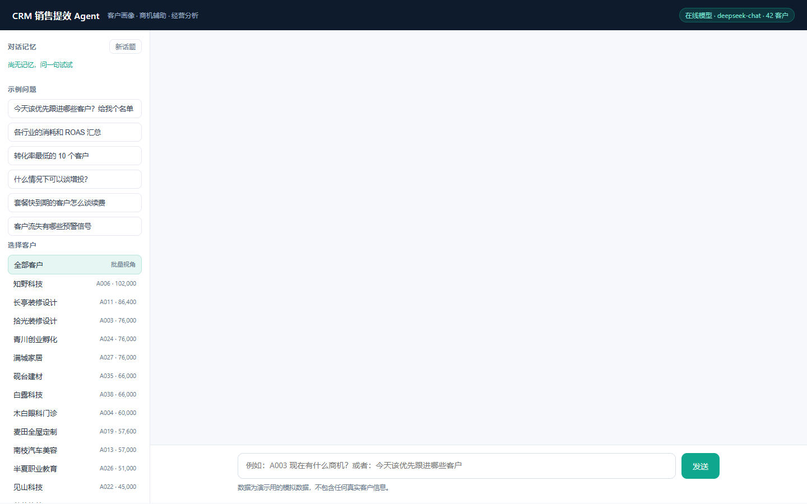
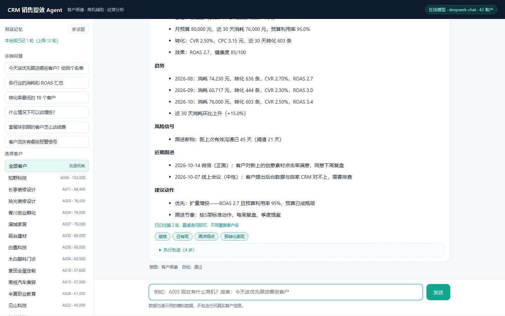
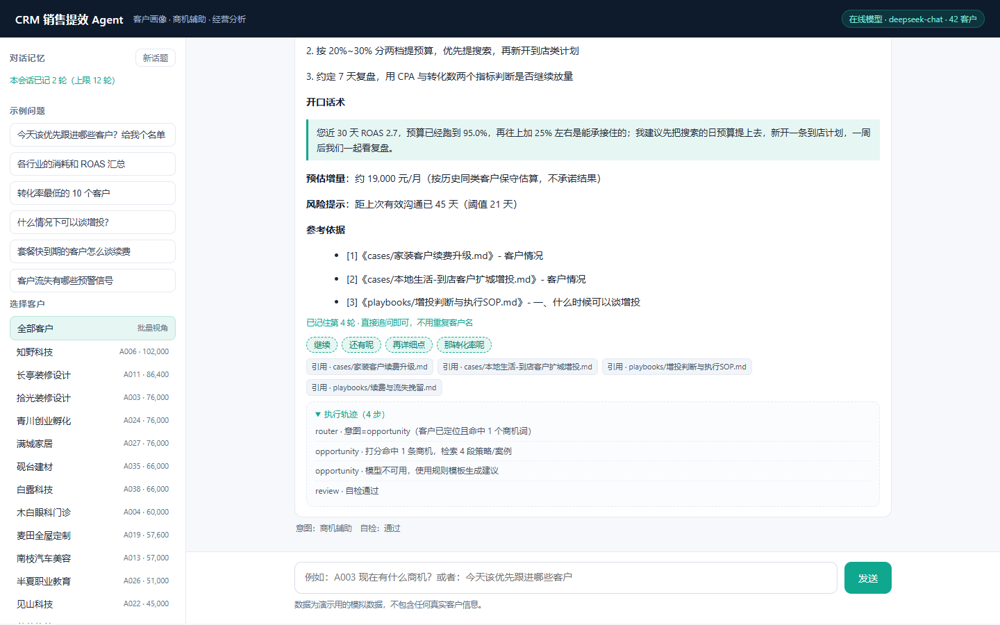
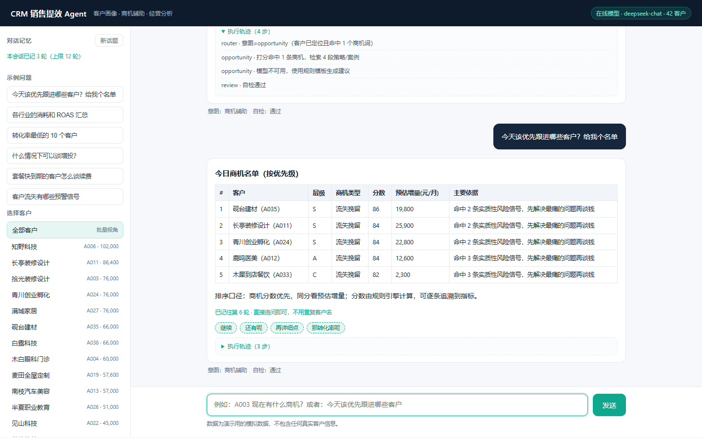
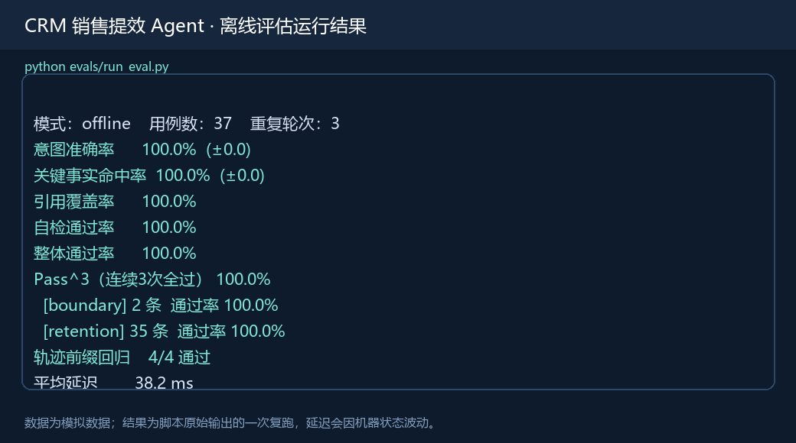

# 3 分钟演示录屏脚本

> 录制建议：1920×1080，浏览器窗口铺满内容区，字体调到 125%；先跑 `python -m uvicorn api.server:app --port 8000`，浏览器开 `http://127.0.0.1:8000`。录屏工具用 OBS 或 Windows 自带 Xbox Game Bar（Win+G）。**不要录到 `.env`、终端里的 Key、桌面其他文件。**

## 截图对照（本地实际运行）

下面 5 张截图对应本脚本的分镜，均由本地启动服务后浏览器实际截取；数据为模拟数据，不含真实客户信息。

| 分镜 | 截图 |
|---|---|
| 0:00–0:20 网页首屏 |  |
| 0:20–1:05 客户画像 |  |
| 1:05–1:50 商机 + 话术（含执行轨迹） |  |
| 1:50–2:30 批量视角与经营分析 |  |
| 2:30–3:00 评估与边界 |  |

> 第 5 张为 `python evals/run_eval.py` 的原始输出渲染图；单次复跑的延迟会因机器状态波动，权威统计口径以 `evals/report.md` 为准。

## 分镜

### 0:00–0:20 ｜开场：说清痛点
画面：网页首屏，鼠标停在左侧示例问题上。
口播：
> 中小客户销售手上一般有六七十个广告主，最花时间的不是打电话，而是打电话前判断"这个客户现在到底该加量、该续费还是该挽留"。我做了这个 Agent，把这件事变成一句话。

### 0:20–1:05 ｜客户画像
操作：点「A003 这个客户什么情况，帮我出个画像」，或直接在输入框输入。
重点指着屏幕讲：
- 「一句话判断」——这是早会上能直接复述的判断；
- 「风险信号」——跟进断档 24 天、套餐 17 天后到期，都是规则算出来的，不是模型猜的；
- 「趋势」——三个月消耗与 CVR 的走向。
口播：
> 它先把四张表合成一张画像卡。注意风险信号这部分，是五条规则命中出来的，每条都能点回具体数字，所以销售敢照着这个名单打电话。

### 1:05–1:50 ｜商机 + 话术（核心）
操作：输入「A003 现在有什么商机」。
讲：
- 推荐动作：续费（不是增投）——因为它 17 天后到期，业务优先级是"先续约再谈量"；
- 三步做法 + 开口话术（可以直接念）；
- 预估增量 + 风险提示 + 参考依据（知识库案例）；
- 展开「执行轨迹」，展示 router → opportunity → review 三步。
口播：
> 这里我特意把规则和模型分开：分数是规则算的，模型只负责把事实说成人话。所以哪怕模型今天抽风，分数也不会错。

### 1:50–2:30 ｜批量视角 + 经营分析
操作 1：输入「今天该优先跟进哪些客户」→ 出名单表格。
口播：
> 这是"几百个客户里今天先打给谁"，按商机分数排，带预估增量。
操作 2：输入「转化率最低的 10 个客户」→ 出 SQL + 结果 + 归因。
口播：
> 自然语言直接出数，下面会给出 SQL，方便运营核对口径；SQL 走白名单和只读连接，写操作根本执行不了。
操作 3：输入「A003 和 A011 谁的 ROAS 更高」→ 出对比结论（两边数字都点名）。
口播：
> 比较类问题它不会含糊，会说清谁高、高多少；比的是消耗还是 CVR，取决于我问的是哪个指标。

### 2:30–3:00 ｜评估与边界（加分项）
操作：切终端跑 `python evals/run_eval.py`，停在结果表。
口播：
> 我给它写了 37 条用例，意图准确率 100%，引用覆盖率 100%。唯一没通过的是"A003 近 45 天消耗"——库里只有 30 天和月度口径，自定义时间窗口答不了，这条我留在评估集里没删，写在 README 的已知短板。

---

## 录屏前检查清单

- [ ] `.env` 里 Key 已填，`/api/health` 显示"在线模型"
- [ ] 数据已重建：`python data/generate_data.py`
- [ ] 四条演示问题都提前跑一遍，确认输出不是空/报错
- [ ] 浏览器缩放 100%，侧栏客户列表可见
- [ ] 录完导出 MP4，控制在 60MB 以内（GitHub 附件/网盘都方便）
